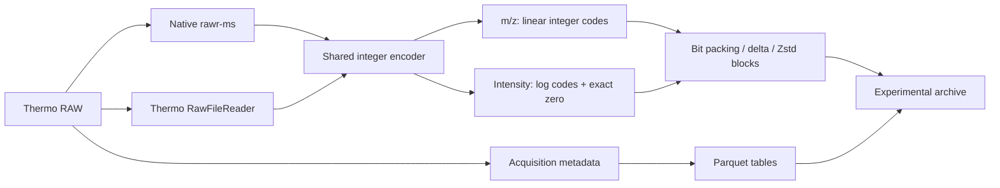

<div align="center">

# mzpeak-rs

### Store spectra. Measure size, speed, and error.

An independent Rust implementation using Apache Arrow and Parquet.<br>
Includes a benchmark study of direct RAW conversion.

[**Results**](#measured-results) · [**Design**](#integer-storage) · [**Quick start**](#use-the-rust-crate) · [**Writeup**](benchmarks/raw-integer-2026-10/WRITEUP.md) · [**Slides**](benchmarks/raw-integer-2026-10/raw-integer-archive.pptx)

[](#attribution-and-license)
[](benchmarks/raw-integer-2026-10/RESULTS.md)
[](benchmarks/raw-integer-2026-10/evidence/validation.json)

</div>

This project tests how integer storage can reduce file size within specified error limits. The experimental converter reads Thermo RAW files directly. It uses either native **rawr-ms** or **Thermo RawFileReader**. Both readers supply data to the same encoder.

This repository contains the Rust crate and the benchmark study. **The study measures a separate experimental converter. It does not measure the current Rust crate.** The experimental archive is not an official mzPeak file. The [HUPO-PSI mzPeak project](https://github.com/HUPO-PSI/mzPeak) maintains the official implementation.

## Measured results

<!-- BEGIN INSTRUMENT COMPARISON -->
**13 RAW files · 49.48 GB · 11 instrument models represented · two official baselines**

The table uses the latest available validated comparison for each baseline. Every speedup pairs native and official runs from the same campaign.

| Official baseline | Eligible files | Conversion speedup | Less output storage |
|:--|--:|--:|--:|
| **Default, Zstd 3** | **11/13** | **4.74×** | **73.14%** |
| **Delta, Zstd 3** | **11/13** | **6.19×** | **61.42%** |

Speedups are paired geometric means with equal weight per file. Storage reduction uses combined bytes on eligible files. Failed baselines receive no ratio.

### Full instrument range: native versus official default and delta

Each cell has two lines: **Default**, then **Delta:50**. Time, RAM, and archive cells show **ours / official**. All times and RAM values are medians. The two comparisons use different nodes and native builds; each line keeps its matched native measurement.

| Instrument / dataset / acquisition | RAW GB | Baseline | Time, s<br>ours / official | Speedup | Peak process RAM, GiB<br>ours / official | Archive, MB<br>ours / official | Less storage | Status<br>ours / official |
|:--|--:|:--|--:|--:|--:|--:|--:|:--|
| Q Exactive HF<br>HeLa control<br>DDA; HeLa control | 0.714 | Default<br>Delta | 14.86 / 61.82<br>9.58 / 50.51 | **4.12×**<br>**5.26×** | 1.62 / 1.26<br>1.63 / 1.66 | 240.5 / 1,080.1<br>240.5 / 713.6 | 77.7%<br>66.3% | Pass / Pass<br>Pass / Pass |
| Orbitrap Fusion<br>[PXD017803](https://www.ebi.ac.uk/pride/archive/projects/PXD017803)<br>DDA / FAIMS; TMT, hrMS2 | 0.116 | Default<br>Delta | 3.26 / 16.97<br>2.08 / 20.47 | **5.15×**<br>**8.79×** | 0.16 / 0.30<br>0.16 / 0.32 | 26.4 / 45.4<br>26.4 / 42.1 | 41.9%<br>37.4% | Pass / Pass<br>Pass / Pass |
| Orbitrap Eclipse<br>[PXD023203](https://www.ebi.ac.uk/pride/archive/projects/PXD023203)<br>FAIMS / SPS; TMTpro | 0.229 | Default<br>Delta | 7.44 / 40.06<br>4.40 / 25.30 | **5.38×**<br>**7.16×** | 0.22 / 0.26<br>0.23 / 0.34 | 63.5 / 107.1<br>63.5 / 99.8 | 40.8%<br>36.4% | Pass / Pass<br>Pass / Pass |
| Orbitrap Ascend<br>[PXD043660](https://www.ebi.ac.uk/pride/archive/projects/PXD043660)<br>TMT16; hrMS2 | 0.689 | Default<br>Delta | 15.33 / 59.79<br>8.88 / 47.02 | **3.94×**<br>**5.07×** | 1.52 / 0.64<br>1.52 / 1.05 | 222.7 / 829.9<br>222.7 / 540.2 | 73.2%<br>58.8% | Pass / Pass<br>Pass / Pass |
| Q Exactive HF<br>[PXD019848](https://www.ebi.ac.uk/pride/archive/projects/PXD019848)<br>HeLa; non-FAIMS | 0.689 | Default<br>Delta | 14.99 / 61.07<br>9.51 / 61.33 | **4.04×**<br>**5.90×** | 1.56 / 1.32<br>1.56 / 1.67 | 231.6 / 1,032.0<br>231.6 / 683.8 | 77.6%<br>66.1% | Pass / Pass<br>Pass / Pass |
| Fusion Lumos<br>[PXD046211](https://www.ebi.ac.uk/pride/archive/projects/PXD046211)<br>TMTpro; single-cell study | 0.734 | Default<br>Delta | 14.32 / 64.81<br>8.88 / 65.02 | **4.53×**<br>**6.83×** | 1.32 / 0.76<br>1.32 / 1.03 | 193.4 / 620.7<br>193.4 / 454.0 | 68.8%<br>57.4% | Pass / Pass<br>Pass / Pass |
| LTQ Orbitrap Velos<br>[PXD005780](https://www.ebi.ac.uk/pride/archive/projects/PXD005780)<br>DDA; gut metaproteome | 0.936 | Default<br>Delta | 14.65 / 68.08<br>11.09 / 51.96 | **5.85×**<br>**4.28×** | 2.45 / 1.04<br>2.45 / 1.64 | 351.8 / 1,451.4<br>351.8 / 976.1 | 75.8%<br>64.0% | Pass / Pass<br>Pass / Pass |
| Q Exactive HF-X<br>[PXD053241](https://www.ebi.ac.uk/pride/archive/projects/PXD053241)<br>Wide-window DDA | 1.176 | Default<br>Delta | 26.44 / 109.28<br>15.17 / 110.46 | **5.66×**<br>**8.97×** | 1.39 / 0.56<br>1.39 / 1.29 | 347.7 / 1,130.4<br>347.7 / 819.6 | 69.2%<br>57.6% | Pass / Pass<br>Pass / Pass |
| Q Exactive<br>[PXD000612](https://www.ebi.ac.uk/pride/archive/projects/PXD000612)<br>DDA; phosphoproteome | 1.542 | Default<br>Delta | 23.31 / 104.03<br>16.95 / 86.55 | **4.46×**<br>**5.11×** | 4.32 / 1.10<br>4.31 / 2.08 | 629.7 / 2,616.0<br>629.7 / 1,793.9 | 75.9%<br>64.9% | Pass / Pass<br>Pass / Pass |
| Q Exactive Plus<br>[PXD002370](https://www.ebi.ac.uk/pride/archive/projects/PXD002370)<br>Label-free; UPS1 / yeast | 1.930 | Default<br>Delta | 34.33 / 148.04<br>22.26 / 125.29 | **4.30×**<br>**4.98×** | 5.23 / 0.89<br>5.23 / 1.64 | 801.6 / 3,246.6<br>801.6 / 2,237.7 | 75.3%<br>64.2% | Pass / Pass<br>Pass / Pass |
| Orbitrap Exploris 480<br>[PXD063416](https://www.ebi.ac.uk/pride/archive/projects/PXD063416)<br>DIA; HeLa / yeast, 10 m/z | 1.998 | Default<br>Delta | 22.26 / 115.42<br>12.98 / 96.91 | **5.18×**<br>**7.70×** | 0.39 / 0.45<br>0.39 / 1.00 | 376.8 / 815.4<br>376.8 / 673.6 | 53.8%<br>44.1% | Pass / Pass<br>Pass / Pass |
| Orbitrap Astral*<br>[PXD046453](https://www.ebi.ac.uk/pride/archive/projects/PXD046453)<br>DIA; 2 Th, 30 min | 16.948 | Default<br>Delta | — / —<br>— / — | —<br>— | — / —<br>— / — | — / —<br>— / — | —<br>— | Metadata / Metadata<br>Metadata / Metadata |
| Orbitrap Astral<br>[PXD049028](https://www.ebi.ac.uk/pride/archive/projects/PXD049028)<br>DIA; 2 Th, 60 min | 21.777 | Default<br>Delta | 268.10 / —<br>157.64 / — | —<br>— | 3.62 / —<br>3.62 / — | 5,467.4 / —<br>5,467.4 / — | —<br>— | Pass / Timeout<br>Pass / Timeout |

**Pass** requires all declared repeats and independent all-point validation. **Timeout** means a required run exceeded 600 seconds. **Metadata** means complete metadata export failed.

**Precision:** ours keeps all source points within 0.01 ppm m/z and 0.1% intensity error. Official default and delta retain exact values after profile-zero filtering. Storage savings include this difference.

**RAM:** both lines report GNU time maximum process RSS, not concurrent process-tree memory. GiB means 2³⁰ bytes; MB and GB are decimal units. Native RAM is higher on several instruments.

**Matched campaigns:** Default uses the later native/vendor campaign on mem1 (8 CPUs, 64 GiB). Delta uses the latest campaign that measured delta on tta1 (8 CPUs, 32 GiB). The native signal binaries differ: `f27b8331` and `53a4ac2e`. Each ratio uses its own matched native run; no timing is transferred between campaigns. Delta has not been measured with the later binary.

Default retains seven repeats for the first three files and three for the rest. Delta retains seven for the first eight files and three for the rest. Each mode has one excluded warmup. The user-requested amendment preserved completed runs and frozen binaries.

The Astral30 instrument name comes from the project record. Its reader reported an unknown model. These data cover Thermo RAW, not other vendor formats.

[Instrument and acquisition evidence](benchmarks/raw-integer-2026-10/evidence/coverage.json) · [Default campaign runs](benchmarks/raw-integer-2026-10/evidence/conversion-results.json) · [Delta campaign runs and validation](benchmarks/raw-integer-2026-10/evidence/native-delta-results.json)

<details>
<summary>Thermo-reader option and earlier campaign history</summary>

Our Thermo RawFileReader path is **1.74× faster** and uses **74.43% less combined storage** than official default on 10/13 eligible files. Its corrected process-tree RSS ratio is 0.71× official. These measurements belong to the mem1 campaign. [Full reader-mode results](benchmarks/raw-integer-2026-10/RESULTS.md).

The original hybrid campaign used vendor code for metadata and calibration. Its 268 attempts and recovery limits remain in the [historical evidence](benchmarks/raw-integer-2026-10/evidence/original-warrior.json). Those timings are not used above.

</details>
<!-- END INSTRUMENT COMPARISON -->

In the latest default campaign, the native converter passed complete validation on **12/13 files**. The validator examined **3,355,346,983 points**. All **1,009,282,702 zero values** remained zero. The official converter completed only 11 of these files. Thus, only 11 files have a valid speedup comparison.

The total error limits are **0.01 ppm for m/z** and **0.1% for intensity**. The experimental archive keeps every source point. Official default keeps retained values unchanged, but it can remove interior zero runs. The two formats therefore have different precision requirements. The storage comparison includes this difference.

[All reader-mode times, RAM and sizes →](benchmarks/raw-integer-2026-10/RESULTS.md) · [Per-repeat JSON →](benchmarks/raw-integer-2026-10/evidence/conversion-results.json)

## Integer storage

A floating-point value stores an exponent and a mantissa. The experimental encoder converts signal values to integers within a specified relative-error limit. It then compresses the integer data.



Both readers read RAW directly. Neither reader requires an intermediate mzML file. The user selects the reader. Native conversion does not automatically switch to the Thermo reader. The independent validator uses the Thermo reader for its reference values.

| Layer | Representation | Reason |
|:--|:--|:--|
| m/z | Linear integer codes relative to each block's minimum | Bound error relative to the original value |
| Positive intensity | Logarithmic integer codes | Allocate relative precision across the dynamic range |
| Zero intensity | Reserved zero code | Preserve every zero and its position |
| Signal | Independently compressed blocks of at most 16,384 points per axis | Decode selected blocks without a full signal scan |
| Index | Compressed block directory | Locate each spectrum's signal |
| Acquisition metadata | Parquet tables and JSON | Keep scan, precursor and instrument context accessible |

For m/z, let `b` be the minimum value in a block. A step of `Δ = 2bεq` gives a rounding error of at most `bεq`. Because `x ≥ b`, the relative error is at most `εq`.

For positive intensity, the logarithmic step is `h = 2 ln(1 + εI)`. The decoded value divided by the source value stays between `1/(1 + εI)` and `1 + εI`.

The encoder reserves a margin for reader error. It also examines the error after floating-point reconstruction. The independent validator examines the saved output.

[Quantization derivation, reader-error composition and archive layout →](benchmarks/raw-integer-2026-10/WRITEUP.md#storage-design)

## Signal error

The big Astral validation includes **all 744,726 scans and 1,511,811,155 points**. All **162,582,445 zero values** remained zero.

| Big Astral error | Mean absolute | 99th percentile¹ | Maximum | Limit |
|:--|--:|--:|--:|--:|
| m/z, ppm | 0.001859 | ≈0.007684 | 0.009055 | 0.01 |
| Positive intensity, % | 0.049948 | ≈0.098950 | 0.09999990 | 0.1 |

¹ The percentile values use the rounded upper endpoints of histogram intervals. The calculation includes every point. Relative-intensity statistics exclude zero values.

The sum of intensity across the file changed by **−0.00006401%**. The largest scan TIC error was **0.08622%**. TIC means total ion current. These measurements use decoded arrays. A small change in the total does not give a smaller error limit for each peak.

**The output passed numerical validation. We have not tested whether the changes affect peptide identification, false discovery rate, or downstream quantification.**

[Big Astral distributions →](benchmarks/raw-integer-2026-10/evidence/astral-fidelity.json) · [HeLa distributions →](benchmarks/raw-integer-2026-10/evidence/hela-fidelity.json)

## Query speed and startup time

The native decoder processes spectra in batches. On the big Astral, it reduces warm-query time. Archive opening still takes more time than the official reader.

| Workload | Native warm | Official warm | Native open + first query | Official open + first query |
|:--|--:|--:|--:|--:|
| XIC, 494 scans | 1.068 s | 1.234 s | 5.195 s | 3.243 s |
| MS2 arrays, 50,208 scans | 4.556 s | 7.053 s | 8.693 s | 8.999 s |

The warm MS2 batch is **1.55× faster**. Peak process RSS is **3.87 GiB**, compared with **4.75 GiB** for the official reader. Opening takes approximately **4.12 s**, compared with **1.84 s**. The XIC takes more total time when the measurement includes archive opening.

XIC means extracted ion chromatogram. Each query uses the same selected scans. Seven repeats use a new process and a randomized order. The filesystem cache is warm. Each decoder uses one worker. The benchmark uses no persistent index or decoded-signal cache. These results apply to two queries. They do not measure SQL or DuckDB performance.

[Query protocol and every sample →](benchmarks/raw-integer-2026-10/evidence/astral-queries.json)

## Failures and comparison rules

| Case | Outcome | Treatment |
|:--|:--|:--|
| Astral30 | Both custom paths encoded signal, then failed instrument metadata; official also failed metadata mapping | No complete-archive ratio |
| Exploris, vendor mode | Retained output validated; third measured conversion timed out | Vendor comparison excluded |
| Big Astral | Native completed and validated; vendor and official timed out during warmup | Native median **268.10 s**; no baseline speedup |

The latest default campaign used eight CPUs and a 64 GiB allocation. Each mode had one warmup run. The analysis excludes warmup time. The first three completed cases retain seven measured repeats. The remaining cases use three repeats after a documented protocol change. The binaries and error limits did not change.

A comparison requires all specified repeats to succeed. It also requires matching signal hashes and independent validation of every point. A 600-second timeout is a failed conversion.

The delta comparison uses the separate native/default/delta campaign. Its timings remain paired within that campaign. Earlier process-tree RSS samples missed child processes from worker threads. Those memory measurements are invalid. The reader-mode results use the corrected sampler. The main comparison table uses maximum process RSS for both campaigns.

Run the verification script:

```bash
python3 benchmarks/raw-integer-2026-10/verify_results.py
```

The script examines all 39 reader-mode cells and checks the main default/delta table. It verifies speedups, storage totals, repeat eligibility, signal hashes, and recorded error limits. It does not repeat RAW conversion.

[Protocol and reproduction scope →](benchmarks/raw-integer-2026-10/REPRODUCIBILITY.md) · [Frozen runtime hashes →](benchmarks/raw-integer-2026-10/evidence/execution.json) · [Failure evidence →](benchmarks/raw-integer-2026-10/evidence/failures)

## Use the Rust crate

The Rust crate provides Arrow/Parquet readers and writers. It also provides ZIP containers, mzML conversion, optional Python bindings, and optional vendor integrations. Its Parquet signal layout differs from the experimental integer archive.

### Build and convert mzML

```bash
git clone https://github.com/filiprumenovski/mzpeak-rs.git
cd mzpeak-rs
cargo build --release --locked

./target/release/mzpeak convert input.mzML output.mzpeak
./target/release/mzpeak info output.mzpeak
./target/release/mzpeak validate output.mzpeak
```

The current CLI `convert` command takes mzML input. Thermo and Bruker integrations are available through optional library features and examples. This CLI does not run the experimental converter.

| Capability | Cargo feature / entry point |
|:--|:--|
| mzML parsing and conversion | `mzml` — enabled by default |
| Python extension | `python` — build with maturin |
| Thermo RAW integration | `thermo` — vendor runtime required |
| Bruker TDF integration | `tdf` — vendored `timsrust` fork |
| Parallel mzML decoding | `mzml-parallel` |

### Write spectra from Rust

```rust
use mzpeak::dataset::MzPeakDatasetWriter;
use mzpeak::metadata::MzPeakMetadata;
use mzpeak::writer::{PeakArrays, SpectrumArrays, WriterConfig};

fn main() -> Result<(), Box<dyn std::error::Error>> {
    let metadata = MzPeakMetadata::new();
    let mut run = MzPeakDatasetWriter::new(
        "example.mzpeak", &metadata, WriterConfig::default(),
    )?;
    let peaks = PeakArrays::new(vec![400.0, 500.0], vec![10_000.0, 25_000.0]);
    let spectrum = SpectrumArrays::new_ms1(0, 1, 60.0, 1, peaks);
    run.write_spectrum_arrays(&spectrum)?;
    run.close()?;
    Ok(())
}
```

This example uses the v1 dataset writer. The v2 writer separates spectrum metadata from peak rows. The ZIP container does not apply additional compression to Parquet members. Thus, readers can seek within the container. Generic Parquet tools can read extracted members. They do not automatically interpret every container or schema.

### Python

Install maturin in a Python virtual environment. Then build the extension:

```bash
maturin develop --release --features python
```

```python
import mzpeak

with mzpeak.MzPeakReader("example.mzpeak") as run:
    for spectrum in run.iter_spectra():
        print(spectrum.scan_number, spectrum.num_peaks)
```

[Python API →](docs/PYTHON_API.md) · [Rust examples →](examples) · [Schema documentation →](docs/SCHEMA_V2.md)

## Documentation and development

| Start here | Contents |
|:--|:--|
| [Technical writeup](benchmarks/raw-integer-2026-10/WRITEUP.md) | Design, mathematical bounds, methods, results and limitations |
| [Presentation](benchmarks/raw-integer-2026-10/raw-integer-archive.pptx) | 12 slides with editable charts and tables |
| [Benchmark package](benchmarks/raw-integer-2026-10/README.md) | Full result set and provenance |
| [Criterion guide](benches/README.md) | Synthetic benchmarks of the Rust crate |
| [Vendor coverage](docs/vendor_coverage.md) | Ingestion contract and coverage requirements |
| [Contributing](CONTRIBUTING.md) | Development and review workflow |

```bash
cargo test --locked
cargo fmt --all -- --check
cargo bench --bench conversion
cargo bench --bench query_performance
```

Further work must improve instrument metadata coverage, reduce native-reader memory, and reduce archive opening time. It must also test downstream proteomics results. The reproduction notes describe the lab setup. There is no portable installer for the experimental converter. This package excludes RAW datasets, proprietary vendor assemblies, and private reader source. Keep the original RAW files.

## Attribution and license

This is an independent project. The [HUPO-PSI mzPeak team](https://github.com/HUPO-PSI/mzPeak) developed the official format and reference implementation. See the [mzPeak paper](https://doi.org/10.1021/acs.jproteome.5c00435). The study uses [rawr-ms](https://github.com/filiprumenovski/rawr-ms), Thermo RawFileReader, Arrow/Parquet, and Zstandard. Earlier work on numerical compression includes [MS-Numpress](https://pmc.ncbi.nlm.nih.gov/articles/PMC4047472/).

Licensed under [MIT](LICENSE-MIT) or [Apache-2.0](LICENSE-APACHE), at your option. See vendored dependencies for their own license terms.
