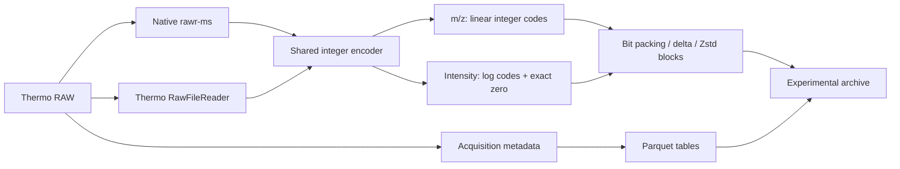

<div align="center">

# mzpeak-rs

### Store spectra. Measure size, speed, and error.

An independent Rust implementation using Apache Arrow and Parquet.<br>
Includes a benchmark study of direct RAW conversion.

[**Results**](#measured-results) · [**Official Python compatibility**](#use-the-official-python-interface) · [**Design**](#integer-storage) · [**Install adapter**](python-adapter/README.md) · [**Writeup**](benchmarks/raw-integer-2026-10/WRITEUP.md) · [**Slides**](benchmarks/raw-integer-2026-10/raw-integer-archive.pptx)

[](#attribution-and-license)
[](benchmarks/raw-integer-2026-10/RESULTS.md)
[](benchmarks/raw-integer-2026-10/evidence/validation.json)

</div>

This project tests how integer storage can reduce file size within specified error limits. The experimental converter reads Thermo RAW files directly. It uses either native **rawr-ms** or **Thermo RawFileReader**. Both readers supply data to the same encoder.

**Use the official Python interface with our integer archives.** The [compatibility adapter](#use-the-official-python-interface) reuses the official reader's metadata and query methods with our signal decoder. Existing query code can use the tested interface by changing the reader import. The big Astral comparison checks every scan and retained signal point.

This repository contains the Rust crate and a separate experimental converter study. **The benchmark results measure the experimental converter.** Its archives require the adapter; unmodified official readers cannot open them. The [HUPO-PSI mzPeak project](https://github.com/HUPO-PSI/mzPeak) maintains the official format and reference implementation.

## Measured results

<!-- BEGIN INSTRUMENT COMPARISON -->
**13 RAW files · 49.48 GB · 11 instrument models represented · two official baselines**

**12 native outputs passed independent validation: 3,355,346,983 points, including the complete 60-minute Astral run.** The table uses the latest validated comparison for each baseline. Every speedup pairs runs from the same campaign.

| Official baseline | Eligible files | Conversion speedup | Less output storage |
|:--|--:|--:|--:|
| **Default, Zstd 3** | **11/13** | **4.74×** | **73.14%** |
| **Delta, Zstd 3** | **11/13** | **6.19×** | **61.42%** |

Speedups are paired geometric means with equal weight per file. Storage reduction uses combined bytes on eligible files. Ratios require completed, validated comparisons.

### Full instrument range: native versus official default and delta

One row per file. Times and archive sizes are shown directly. Official time and size refer to default encoding. Delta means `delta:50`; both official modes use Zstd 3.

Each baseline uses its latest matched campaign. Default and delta used different nodes and native builds. No timing is transferred between them.

| Instrument / acquisition | Native s | Official s | Native GB | Official GB | Default speedup | Delta speedup |
|:--|--:|--:|--:|--:|--:|--:|
| Q Exactive HF (control)<br>DDA; HeLa control | 14.86 | 61.82 | 0.240 | 1.080 | **4.12×** | **5.26×** |
| [Fusion](https://www.ebi.ac.uk/pride/archive/projects/PXD017803)<br>DDA / FAIMS; TMT, hrMS2 | 3.26 | 16.97 | 0.026 | 0.045 | **5.15×** | **8.79×** |
| [Eclipse](https://www.ebi.ac.uk/pride/archive/projects/PXD023203)<br>FAIMS / SPS; TMTpro | 7.44 | 40.06 | 0.063 | 0.107 | **5.38×** | **7.16×** |
| [Ascend](https://www.ebi.ac.uk/pride/archive/projects/PXD043660)<br>TMT16; hrMS2 | 15.33 | 59.79 | 0.223 | 0.830 | **3.94×** | **5.07×** |
| [Q Exactive HF](https://www.ebi.ac.uk/pride/archive/projects/PXD019848)<br>HeLa; non-FAIMS | 14.99 | 61.07 | 0.232 | 1.032 | **4.04×** | **5.90×** |
| [Fusion Lumos](https://www.ebi.ac.uk/pride/archive/projects/PXD046211)<br>TMTpro; single-cell study | 14.32 | 64.81 | 0.193 | 0.621 | **4.53×** | **6.83×** |
| [LTQ Orbitrap Velos](https://www.ebi.ac.uk/pride/archive/projects/PXD005780)<br>DDA; gut metaproteome | 14.65 | 68.08 | 0.352 | 1.451 | **5.85×** | **4.28×** |
| [Q Exactive HF-X](https://www.ebi.ac.uk/pride/archive/projects/PXD053241)<br>Wide-window DDA | 26.44 | 109.28 | 0.348 | 1.130 | **5.66×** | **8.97×** |
| [Q Exactive](https://www.ebi.ac.uk/pride/archive/projects/PXD000612)<br>DDA; phosphoproteome | 23.31 | 104.03 | 0.630 | 2.616 | **4.46×** | **5.11×** |
| [Q Exactive Plus](https://www.ebi.ac.uk/pride/archive/projects/PXD002370)<br>Label-free; UPS1 / yeast | 34.33 | 148.04 | 0.802 | 3.247 | **4.30×** | **4.98×** |
| [Exploris 480](https://www.ebi.ac.uk/pride/archive/projects/PXD063416)<br>DIA; HeLa / yeast, 10 m/z | 22.26 | 115.42 | 0.377 | 0.815 | **5.18×** | **7.70×** |
| [Astral (30 min)](https://www.ebi.ac.uk/pride/archive/projects/PXD046453)<br>DIA; 2 Th, 30 min | — | — | — | — | Outside scope² | Outside scope² |
| [Astral (60 min)](https://www.ebi.ac.uk/pride/archive/projects/PXD049028)<br>DIA; 2 Th, 60 min; **native validated** | 268.10 | 1,374.09¹ | 5.467 | 11.072¹ | Not paired¹ | 600 s limit³ |

¹ **Astral’s official values are from a completed single run on mem4.** Native values are the three-run median on mem1. The official archive now has a complete retained-signal comparison through the adapter. These are separate runs, not a paired speedup, and the official single run is excluded from aggregates. All other displayed times are campaign medians.

<details>
<summary>Astral run provenance and validation</summary>

#### Completed big Astral conversions

**Same 21.78 GB RAW file; separate allocations and validation scopes. These times do not form a paired speedup.**

| Conversion | Runs | Time, s | Peak RAM, GiB | Archive, GB | Validation |
|:--|--:|--:|--:|--:|:--|
| Native, latest campaign (mem1) | 3 | **268.10** median | 3.62 | **5.47** | All 1,511,811,155 points |
| Official default, query setup (mem4) | 1 | **1374.09** | 1.59 | **11.07** | All retained points compared |

Native validation covered all **744,726 scans** and preserved all **162,582,445 zeros**. The official run exited successfully in **22m 54s**. All 1,392,038,446 retained official points now pass comparison against the independently RAW-validated native query fixture. This adds cross-reader evidence; it does not replace an independent official-to-RAW oracle. It is excluded from speedup and storage-saving aggregates. Official delta has no completed Astral conversion in the saved evidence.

[Successful official conversion evidence](benchmarks/raw-integer-2026-10/evidence/astral-official-single.json) · [Timing log](benchmarks/raw-integer-2026-10/evidence/astral-official-single.time) · [Adapter validation](benchmarks/raw-integer-2026-10/ADAPTER_VALIDATION.md)

</details>

² The tested converters do not support complete metadata export for the separate 30-minute Astral file. It is outside the validated set. Dashes mean no eligible measurement.

³ The official delta converter exceeded the campaign’s 600-second limit. Native conversion and validation completed.

**Precision:** ours keeps all source points within 0.01 ppm m/z and 0.1% intensity error. Official default and delta retain exact values after profile-zero filtering. Storage savings include this difference.

**Peak RAM varies by instrument.** Native conversion uses more memory on several instruments. Expand the measurements below for every time, RAM value, and archive size.

<details>
<summary><strong>Full measurements: time, RAM, and archive size</strong></summary>

Each cell contains one value. Times and RAM values are medians. RAM is GNU time maximum process RSS, not concurrent process-tree memory. GiB means 2³⁰ bytes; MB and GB are decimal units.

#### Native versus official default

| Instrument | Native s | Official s | Native GiB | Official GiB | Native MB | Official MB |
|:--|--:|--:|--:|--:|--:|--:|
| Q Exactive HF (control) | 14.86 | 61.82 | 1.62 | 1.26 | 240.5 | 1,080.1 |
| [Fusion](https://www.ebi.ac.uk/pride/archive/projects/PXD017803) | 3.26 | 16.97 | 0.16 | 0.30 | 26.4 | 45.4 |
| [Eclipse](https://www.ebi.ac.uk/pride/archive/projects/PXD023203) | 7.44 | 40.06 | 0.22 | 0.26 | 63.5 | 107.1 |
| [Ascend](https://www.ebi.ac.uk/pride/archive/projects/PXD043660) | 15.33 | 59.79 | 1.52 | 0.64 | 222.7 | 829.9 |
| [Q Exactive HF](https://www.ebi.ac.uk/pride/archive/projects/PXD019848) | 14.99 | 61.07 | 1.56 | 1.32 | 231.6 | 1,032.0 |
| [Fusion Lumos](https://www.ebi.ac.uk/pride/archive/projects/PXD046211) | 14.32 | 64.81 | 1.32 | 0.76 | 193.4 | 620.7 |
| [LTQ Orbitrap Velos](https://www.ebi.ac.uk/pride/archive/projects/PXD005780) | 14.65 | 68.08 | 2.45 | 1.04 | 351.8 | 1,451.4 |
| [Q Exactive HF-X](https://www.ebi.ac.uk/pride/archive/projects/PXD053241) | 26.44 | 109.28 | 1.39 | 0.56 | 347.7 | 1,130.4 |
| [Q Exactive](https://www.ebi.ac.uk/pride/archive/projects/PXD000612) | 23.31 | 104.03 | 4.32 | 1.10 | 629.7 | 2,616.0 |
| [Q Exactive Plus](https://www.ebi.ac.uk/pride/archive/projects/PXD002370) | 34.33 | 148.04 | 5.23 | 0.89 | 801.6 | 3,246.6 |
| [Exploris 480](https://www.ebi.ac.uk/pride/archive/projects/PXD063416) | 22.26 | 115.42 | 0.39 | 0.45 | 376.8 | 815.4 |
| [Astral (30 min)](https://www.ebi.ac.uk/pride/archive/projects/PXD046453) | — | — | — | — | — | — |
| [Astral (60 min)](https://www.ebi.ac.uk/pride/archive/projects/PXD049028) | 268.10 | — | 3.62 | — | 5,467.4 | — |

#### Native versus official delta

| Instrument | Native s | Official s | Native GiB | Official GiB | Native MB | Official MB |
|:--|--:|--:|--:|--:|--:|--:|
| Q Exactive HF (control) | 9.58 | 50.51 | 1.63 | 1.66 | 240.5 | 713.6 |
| [Fusion](https://www.ebi.ac.uk/pride/archive/projects/PXD017803) | 2.08 | 20.47 | 0.16 | 0.32 | 26.4 | 42.1 |
| [Eclipse](https://www.ebi.ac.uk/pride/archive/projects/PXD023203) | 4.40 | 25.30 | 0.23 | 0.34 | 63.5 | 99.8 |
| [Ascend](https://www.ebi.ac.uk/pride/archive/projects/PXD043660) | 8.88 | 47.02 | 1.52 | 1.05 | 222.7 | 540.2 |
| [Q Exactive HF](https://www.ebi.ac.uk/pride/archive/projects/PXD019848) | 9.51 | 61.33 | 1.56 | 1.67 | 231.6 | 683.8 |
| [Fusion Lumos](https://www.ebi.ac.uk/pride/archive/projects/PXD046211) | 8.88 | 65.02 | 1.32 | 1.03 | 193.4 | 454.0 |
| [LTQ Orbitrap Velos](https://www.ebi.ac.uk/pride/archive/projects/PXD005780) | 11.09 | 51.96 | 2.45 | 1.64 | 351.8 | 976.1 |
| [Q Exactive HF-X](https://www.ebi.ac.uk/pride/archive/projects/PXD053241) | 15.17 | 110.46 | 1.39 | 1.29 | 347.7 | 819.6 |
| [Q Exactive](https://www.ebi.ac.uk/pride/archive/projects/PXD000612) | 16.95 | 86.55 | 4.31 | 2.08 | 629.7 | 1,793.9 |
| [Q Exactive Plus](https://www.ebi.ac.uk/pride/archive/projects/PXD002370) | 22.26 | 125.29 | 5.23 | 1.64 | 801.6 | 2,237.7 |
| [Exploris 480](https://www.ebi.ac.uk/pride/archive/projects/PXD063416) | 12.98 | 96.91 | 0.39 | 1.00 | 376.8 | 673.6 |
| [Astral (30 min)](https://www.ebi.ac.uk/pride/archive/projects/PXD046453) | — | — | — | — | — | — |
| [Astral (60 min)](https://www.ebi.ac.uk/pride/archive/projects/PXD049028) | 157.64 | — | 3.62 | — | 5,467.4 | — |

#### Storage saved versus each official baseline

| Instrument | Default | Delta |
|:--|--:|--:|
| Q Exactive HF (control) | 77.7% | 66.3% |
| [Fusion](https://www.ebi.ac.uk/pride/archive/projects/PXD017803) | 41.9% | 37.4% |
| [Eclipse](https://www.ebi.ac.uk/pride/archive/projects/PXD023203) | 40.8% | 36.4% |
| [Ascend](https://www.ebi.ac.uk/pride/archive/projects/PXD043660) | 73.2% | 58.8% |
| [Q Exactive HF](https://www.ebi.ac.uk/pride/archive/projects/PXD019848) | 77.6% | 66.1% |
| [Fusion Lumos](https://www.ebi.ac.uk/pride/archive/projects/PXD046211) | 68.8% | 57.4% |
| [LTQ Orbitrap Velos](https://www.ebi.ac.uk/pride/archive/projects/PXD005780) | 75.8% | 64.0% |
| [Q Exactive HF-X](https://www.ebi.ac.uk/pride/archive/projects/PXD053241) | 69.2% | 57.6% |
| [Q Exactive](https://www.ebi.ac.uk/pride/archive/projects/PXD000612) | 75.9% | 64.9% |
| [Q Exactive Plus](https://www.ebi.ac.uk/pride/archive/projects/PXD002370) | 75.3% | 64.2% |
| [Exploris 480](https://www.ebi.ac.uk/pride/archive/projects/PXD063416) | 53.8% | 44.1% |
| [Astral (30 min)](https://www.ebi.ac.uk/pride/archive/projects/PXD046453) | — | — |
| [Astral (60 min)](https://www.ebi.ac.uk/pride/archive/projects/PXD049028) | — | — |

A reported measurement requires all declared repeats and independent all-point validation. A timeout means a required run exceeded 600 seconds. Warmups are excluded. No ratio uses a failed baseline.

</details>

<details>
<summary>Campaigns, repeats, and source evidence</summary>

Default uses the later native/vendor campaign on mem1 (8 CPUs, 64 GiB). Delta uses the latest campaign that measured delta on tta1 (8 CPUs, 32 GiB). The native signal binaries differ: `f27b8331` and `53a4ac2e`. Each ratio uses its own matched native run. Delta has not been measured with the later binary.

Default retains seven repeats for the first three files and three for the rest. Delta retains seven for the first eight files and three for the rest. Each mode has one excluded warmup. The documented repeat amendment preserved completed runs and frozen binaries.

The selected RAW files range from 0.116 GB to 21.777 GB. Instrument links open their source project. The Astral30 model comes from its project record; its reader reported an unknown model. These data cover Thermo RAW, not other vendor formats.

[Instrument and acquisition evidence](benchmarks/raw-integer-2026-10/evidence/coverage.json) · [Default campaign runs](benchmarks/raw-integer-2026-10/evidence/conversion-results.json) · [Delta campaign runs and validation](benchmarks/raw-integer-2026-10/evidence/native-delta-results.json)

</details>

<details>
<summary>Thermo RawFileReader conversion option</summary>

Our Thermo RawFileReader path is **1.74× faster** and uses **74.43% less combined storage** than official default on 10/13 eligible files. Its corrected process-tree RSS ratio is 0.71× official. These measurements belong to the mem1 campaign. [Full reader-mode results](benchmarks/raw-integer-2026-10/RESULTS.md).

</details>
<!-- END INSTRUMENT COMPARISON -->

<a id="python-adapter-validation"></a>

## Use the official Python interface

**The adapter connects our integer archives to the official mzPeak Python implementation.** It subclasses the pinned official `MzPeakFile`, keeps its metadata parsing and public query methods, and supplies decoded signal arrays from our archive. Reads work in place, without archive extraction or an mzML intermediate.

Install from a clone in a fresh virtual environment. Source builds require **Python 3.11–3.13, Git, Rust 1.85+, and a C compiler**. The package installs the pinned official reader and compiles its own decoder; no vendor runtime or lab checkout is required.

```bash
git clone https://github.com/filiprumenovski/mzpeak-rs.git
cd mzpeak-rs
python3 -m venv .venv
source .venv/bin/activate
python -m pip install ./python-adapter
python -m mzpeak_compat.example
```

The bundled example compares seven synthetic scans against a matching official archive. The two archives total about **20 KB** and are included in the installed package. [Platform setup and tests →](python-adapter/README.md)

The same query function can read either archive:

```python
from contextlib import closing
from mzpeak import MzPeakFile as OfficialFile
from mzpeak_compat import MzPeakFile as IntegerFile

def spectrum_arrays(run, index):
    spectrum = run[index]
    return spectrum["m/z array"], spectrum["intensity array"]

with open("official.mzpeak", "rb") as handle, closing(OfficialFile(handle)) as run:
    official_mz, official_intensity = spectrum_arrays(run, 100)

with IntegerFile("complete.experimental.zip", filter_profile_zeros=True) as run:
    integer_mz, integer_intensity = spectrum_arrays(run, 100)
```

`filter_profile_zeros=True` matches the official exporter's removal of interior profile zeros. The default preserves every stored point. Compatibility mode scans profile spectra at open to update point counts; it keeps no decoded-signal cache.

**Validated on all 744,726 big Astral scans:** all **1,392,038,446 retained points** agree in order, count, zero positions, and the declared error limits. Maximum differences are **0.009055 ppm m/z** and **0.0999999% intensity**. Default reads preserve all **1,511,811,155 points**, including **162,582,445 zeros**. The same XIC and MS2 workloads also passed.

| Tested interface | Coverage |
|:--|:--|
| Spectrum access | Index, native ID, lists, slices, and finite retention times |
| Array access | Batch ranges, profile/centroid selection, and zero filtering |
| Metadata | Spectra, scans, precursors, selected ions, and acquisition context |
| Other reader operations | Iteration, TIC/BPC, chromatograms, checksums, and file closure |

The installable package is **`mzpeak-integer`**; its import is **`mzpeak_compat`**. It reads existing integer archives. Keep it in a separate environment from this crate's Rust Python extension: the official reader owns the `mzpeak` import. [Package source](python-adapter) · [Full Astral validation](benchmarks/raw-integer-2026-10/ADAPTER_VALIDATION.md).

<details>
<summary>Compatibility scope</summary>

Values agree within the archive's error limits; array dtypes can differ. Exact m/z cutoffs can select different points within the quantization band. Our adapter applies the m/z-window argument; the pinned official reader ignores it, so comparisons use the same explicit array mask. Four official tail queries reached a time limit; native results were checked against official scalar reads for those scan IDs. Empty array ranges and infinite-time inputs have documented behavior. The tested interface does not include SQL, URI inputs, or wavelength data.

[Full adapter checks, boundary results, and provenance →](benchmarks/raw-integer-2026-10/ADAPTER_VALIDATION.md)

</details>

## Integer storage

A floating-point value stores an exponent and a mantissa. The experimental encoder converts signal values to integers within a specified relative-error limit. It then compresses the integer data.



Both readers read RAW directly. Neither reader requires an intermediate mzML file. The user selects the reader. Native conversion does not automatically switch to the Thermo reader. The independent validator uses the Thermo reader for its reference values.

| Layer | Representation | Reason |
|:--|:--|:--|
| m/z | Linear integer codes relative to each block's minimum | Bound error relative to the original value |
| Positive intensity | Logarithmic integer codes | Allocate relative precision across the dynamic range |
| Zero intensity | Reserved zero code | Preserve every zero and its position |
| Signal | Independently compressed blocks of at most 16,384 points per axis | Decode selected blocks without a full signal scan |
| Index | Compressed block directory | Locate each spectrum's signal |
| Acquisition metadata | Parquet tables and JSON | Keep scan, precursor and instrument context accessible |

For m/z, let `b` be the minimum value in a block. A step of `Δ = 2bεq` gives a rounding error of at most `bεq`. Because `x ≥ b`, the relative error is at most `εq`.

For positive intensity, the logarithmic step is `h = 2 ln(1 + εI)`. The decoded value divided by the source value stays between `1/(1 + εI)` and `1 + εI`.

The encoder reserves a margin for reader error. It also examines the error after floating-point reconstruction. The independent validator examines the saved output.

[Quantization derivation, reader-error composition and archive layout →](benchmarks/raw-integer-2026-10/WRITEUP.md#storage-design)

## Signal error

The big Astral validation includes **all 744,726 scans and 1,511,811,155 points**. All **162,582,445 zero values** remained zero.

| Big Astral error | Mean absolute | 99th percentile¹ | Maximum | Limit |
|:--|--:|--:|--:|--:|
| m/z, ppm | 0.001859 | ≈0.007684 | 0.009055 | 0.01 |
| Positive intensity, % | 0.049948 | ≈0.098950 | 0.09999990 | 0.1 |

¹ The percentile values use the rounded upper endpoints of histogram intervals. The calculation includes every point. Relative-intensity statistics exclude zero values.

The sum of intensity across the file changed by **−0.00006401%**. The largest scan TIC error was **0.08622%**. TIC means total ion current. These measurements use decoded arrays. A small change in the total does not give a smaller error limit for each peak.

**The output passed numerical validation. We have not tested whether the changes affect peptide identification, false discovery rate, or downstream quantification.**

[Big Astral distributions →](benchmarks/raw-integer-2026-10/evidence/astral-fidelity.json) · [HeLa distributions →](benchmarks/raw-integer-2026-10/evidence/hela-fidelity.json)

## Query speed and startup time

The native decoder processes spectra in batches. On the big Astral, it reduces warm-query time. Archive opening still takes more time than the official reader.

| Workload | Native warm | Official warm | Native open + first query | Official open + first query |
|:--|--:|--:|--:|--:|
| XIC, 494 scans | 1.068 s | 1.234 s | 5.195 s | 3.243 s |
| MS2 arrays, 50,208 scans | 4.556 s | 7.053 s | 8.693 s | 8.999 s |

The warm MS2 batch is **1.55× faster**. Peak process RSS is **3.87 GiB**, compared with **4.75 GiB** for the official reader. Opening takes approximately **4.12 s**, compared with **1.84 s**. The XIC takes more total time when the measurement includes archive opening.

XIC means extracted ion chromatogram. Each query uses the same selected scans. Seven repeats use a new process and a randomized order. The filesystem cache is warm. Each decoder uses one worker. The benchmark uses no persistent index or decoded-signal cache. These results apply to two queries. They do not measure SQL or DuckDB performance.

[Query protocol and every sample →](benchmarks/raw-integer-2026-10/evidence/astral-queries.json)

<a id="validation-scope-and-comparison-rules"></a>

## Verify the results

```bash
python3 benchmarks/raw-integer-2026-10/verify_results.py
```

This checks the conversion table, paired speedups, storage totals, repeat eligibility, signal hashes, error limits, and full Astral adapter evidence. It uses the published reports; it does not repeat RAW conversion.

[Full measurements and eligibility →](benchmarks/raw-integer-2026-10/RESULTS.md) · [Protocol, revisions, and reproduction scope →](benchmarks/raw-integer-2026-10/REPRODUCIBILITY.md)

## Use the Rust crate

The Rust crate provides Arrow/Parquet readers and writers. It also provides ZIP containers, mzML conversion, optional Python bindings, and optional vendor integrations. Its Parquet signal layout differs from the experimental integer archive.

### Build and convert mzML

```bash
git clone https://github.com/filiprumenovski/mzpeak-rs.git
cd mzpeak-rs
cargo build --release --locked

./target/release/mzpeak convert input.mzML output.mzpeak
./target/release/mzpeak info output.mzpeak
./target/release/mzpeak validate output.mzpeak
```

The current CLI `convert` command takes mzML input. Thermo and Bruker integrations are available through optional library features and examples. This CLI does not run the experimental converter.

| Capability | Cargo feature / entry point |
|:--|:--|
| mzML parsing and conversion | `mzml` — enabled by default |
| Python extension | `python` — build with maturin |
| Thermo RAW integration | `thermo` — vendor runtime required |
| Bruker TDF integration | `tdf` — vendored `timsrust` fork |
| Parallel mzML decoding | `mzml-parallel` |

### Rust and Python APIs

[Writer and reader examples](examples) cover the crate's Arrow/Parquet format. Build its optional Python extension with `maturin develop --release --features python` in a virtual environment.

[Python API →](docs/PYTHON_API.md) · [Rust examples →](examples) · [Schema documentation →](docs/SCHEMA_V2.md)

## Documentation and development

| Start here | Contents |
|:--|:--|
| [Technical writeup](benchmarks/raw-integer-2026-10/WRITEUP.md) | Design, mathematical bounds, methods, results and limitations |
| [Presentation](benchmarks/raw-integer-2026-10/raw-integer-archive.pptx) | 12 slides with editable charts and tables |
| [Benchmark package](benchmarks/raw-integer-2026-10/README.md) | Full result set and provenance |
| [Criterion guide](benches/README.md) | Synthetic benchmarks of the Rust crate |
| [Vendor coverage](docs/vendor_coverage.md) | Ingestion contract and coverage requirements |
| [Contributing](CONTRIBUTING.md) | Development and review workflow |

```bash
cargo test --locked
cargo fmt --all -- --check
cargo bench --bench conversion
cargo bench --bench query_performance
```

Further work must improve instrument metadata coverage, reduce native-reader memory, and reduce archive opening time. It must also test downstream proteomics results. The reproduction notes describe the lab setup. The reader has a standalone install path; RAW conversion still requires the research setup. This package excludes RAW datasets, proprietary vendor assemblies, and private reader source. Keep the original RAW files.

## Attribution and license

This is an independent project. The [HUPO-PSI mzPeak team](https://github.com/HUPO-PSI/mzPeak) developed the official format and reference implementation. See the [mzPeak paper](https://doi.org/10.1021/acs.jproteome.5c00435). The study uses [rawr-ms](https://github.com/filiprumenovski/rawr-ms), Thermo RawFileReader, Arrow/Parquet, and Zstandard. Earlier work on numerical compression includes [MS-Numpress](https://pmc.ncbi.nlm.nih.gov/articles/PMC4047472/).

Licensed under [MIT](LICENSE-MIT) or [Apache-2.0](LICENSE-APACHE), at your option. See vendored dependencies for their own license terms.
